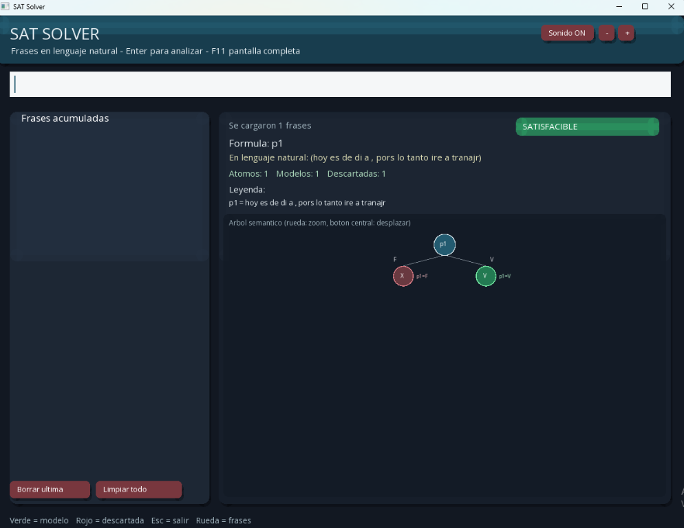
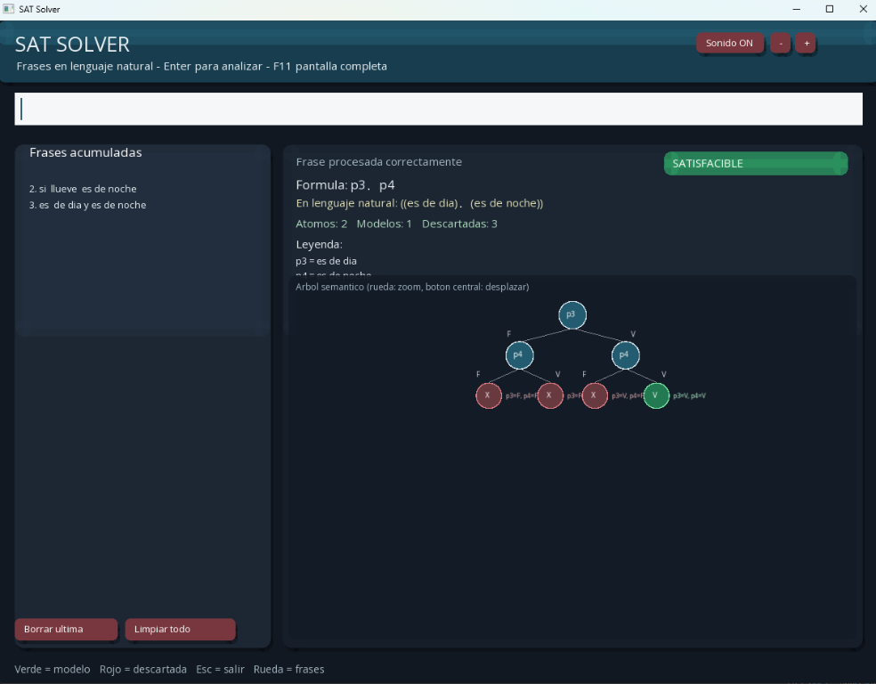

# SAT Solver

Aplicación en C++17. SFML 3 es opcional: cuando está instalada se compila la interfaz gráfica; si no, se compila automáticamente la versión de consola.

## Vista de la aplicación





## Requisitos en Windows

1. Instalar [MSYS2](https://www.msys2.org/).
2. Abrir **MSYS2 MinGW 64-bit** y actualizar/instalar las herramientas:

   ```bash
   pacman -Syu
   pacman -S mingw-w64-x86_64-gcc mingw-w64-x86_64-make mingw-w64-x86_64-sfml
   ```

3. Desde la raíz del proyecto, compilar y ejecutar:

   ```bash
   make clean
   make
   ./build/sat_solver.exe
   ```

   Si SFML no está disponible, el ejecutable funcionará en modo consola.

## Requisitos en macOS

1. Instalar las herramientas de compilación y Homebrew:

   ```bash
   xcode-select --install
   ```

   Si Homebrew no está instalado, hacerlo desde [brew.sh](https://brew.sh/).
2. Instalar SFML y `pkg-config`:

   ```bash
   brew install sfml pkg-config
   ```

3. Desde la raíz del proyecto, compilar y ejecutar:

   ```bash
   make clean
   make
   ./build/sat_solver
   ```

## Permisos y notas

- No se requieren permisos de administrador para compilar o ejecutar; basta con poder leer el proyecto y escribir en `build/`.
- En macOS, si el sistema pregunta si se desea abrir una aplicación descargada, seleccionar **Abrir**. No es necesario otorgar permisos de Accesibilidad.
- En Windows, si SmartScreen muestra una advertencia, verificar que el ejecutable provenga de este proyecto y seleccionar **Más información > Ejecutar de todas formas**.
- Ejecutar los comandos desde la raíz del proyecto, porque `data/` y `assets/` se cargan mediante rutas relativas.
- La interfaz gráfica requiere que las bibliotecas de SFML estén disponibles al ejecutar el programa. El Makefile cambia a consola automáticamente si no las encuentra.
- Las frases no necesitan tener una coma perfecta: si el programa no puede identificar una relación lógica, conserva la frase completa como una proposición y continúa el análisis.
